# Database Schema

PostgreSQL 16 is the source of truth. The ORM models in `backend/app/models/` are the
authoritative column definitions; Alembic migrations in `backend/alembic/versions/` create them.
This document explains structure, relationships and integrity rules.

## Conventions

* UUID primary keys (`uuid4`, generated by the application) for all business entities.
  Natural keys only for catalogue rows (`permissions.code`, `system_settings.key`,
  `agents.id`, `document_sequences.name`).
* Quantities: `NUMERIC(18,4)`. Unit costs: `NUMERIC(18,6)`. Money totals: `NUMERIC(18,4)`.
  Unit conversion factors: `NUMERIC(24,10)`. No floats anywhere.
* `created_at`, `updated_at` (timestamptz, UTC) on all mutable tables; `created_by`,
  `updated_by` (FK users) where a human edits the record.
* Soft deletion = `is_active = false` for master data (products, suppliers, warehouses,
  locations, units, categories, users). **Transactional history is never deleted**: stock
  movements are protected by a database trigger, and documents are cancelled, not removed.
* Human-readable document numbers (`PO-000123`, `GRN-000045`, …) come from
  `document_sequences`, incremented under a row lock inside the creating transaction.

## ER diagram

```mermaid
erDiagram
    companies ||--o{ users : employs
    users ||--o{ user_roles : has
    roles ||--o{ user_roles : granted
    roles ||--o{ role_permissions : includes
    permissions ||--o{ role_permissions : in
    users ||--o{ user_departments : member
    departments ||--o{ user_departments : contains
    users ||--o{ user_warehouse_access : scoped_to
    warehouses ||--o{ user_warehouse_access : visible_to
    users ||--o{ user_sessions : authenticates

    product_categories ||--o{ product_categories : parent
    product_categories ||--o{ products : classifies
    units_of_measure ||--o{ products : measured_in
    units_of_measure ||--o{ unit_conversions : from_to
    products ||--o{ product_suppliers : sourced_from
    suppliers ||--o{ product_suppliers : supplies
    warehouses ||--o{ storage_locations : contains
    storage_locations ||--o{ storage_locations : parent

    products ||--o{ product_batches : batches
    products ||--o{ product_serial_numbers : serials
    products ||--|| product_valuations : valued_by
    products ||--o{ inventory_balances : stocked_as
    storage_locations ||--o{ inventory_balances : holds
    product_batches ||--o{ inventory_balances : batch
    inventory_transactions ||--|{ stock_movements : lines
    products ||--o{ stock_movements : moved
    storage_locations ||--o{ stock_movements : at
    stock_transfers ||--|{ stock_transfer_items : items
    stock_adjustments ||--|{ stock_adjustment_items : items
    products ||--o{ inventory_reservations : reserved

    purchase_requisitions ||--|{ purchase_requisition_items : items
    purchase_requisitions |o--o{ purchase_orders : converted_to
    suppliers ||--o{ purchase_orders : receives
    purchase_orders ||--|{ purchase_order_items : items
    purchase_orders ||--o{ goods_receipts : received_by
    goods_receipts ||--|{ goods_receipt_items : items
    purchase_order_items ||--o{ goods_receipt_items : fulfils
    goods_receipts |o--o| inventory_transactions : posts

    agents ||--o{ agent_tools : exposes
    users ||--o{ conversations : owns
    conversations ||--o{ messages : contains
    conversations ||--o{ agent_execution_logs : traced_by
    users ||--o{ action_approvals : requests
    users ||--o{ audit_logs : acts
    users ||--o{ notification_preferences : prefers
    users ||--o{ notifications : receives

    inventory_balances {
        uuid id PK
        uuid product_id FK
        uuid location_id FK
        uuid warehouse_id FK
        uuid batch_id FK "nullable"
        enum stock_status "unrestricted|damaged|returned|in_transit"
        numeric qty_on_hand
        numeric qty_reserved
    }
    stock_movements {
        uuid id PK
        uuid transaction_id FK
        enum movement_type
        numeric quantity "signed delta"
        numeric unit_cost
        numeric value "signed"
        numeric balance_after
        uuid counterpart_location_id
        uuid performed_by FK
        timestamptz created_at
    }
    product_valuations {
        uuid product_id PK
        enum valuation_method "weighted_average"
        numeric quantity
        numeric average_cost
        numeric total_value
    }
    action_approvals {
        uuid id PK
        string action_type
        jsonb params
        string params_hash "sha256 of canonical params"
        enum status
        string required_permission
    }
```

## Table groups

| Group | Tables |
|---|---|
| Organization & access | companies, users, roles, permissions, role_permissions, user_roles, departments, user_departments, user_warehouse_access, user_sessions, password_reset_tokens |
| Master data | units_of_measure, unit_conversions, product_categories, products, product_suppliers, suppliers, warehouses, storage_locations |
| Inventory | inventory_balances, inventory_transactions, stock_movements, stock_transfers, stock_transfer_items, stock_adjustments, stock_adjustment_items, inventory_reservations, product_batches, product_serial_numbers, product_valuations |
| Purchasing | purchase_requisitions, purchase_requisition_items, purchase_orders, purchase_order_items, goods_receipts, goods_receipt_items |
| AI | agents, agent_tools, agent_execution_logs, conversations, messages, action_approvals |
| System | audit_logs, system_settings, notification_preferences, notifications, attachments, idempotency_records, document_sequences |

`inventory_transactions` is the header of a posting (one business event, e.g. a GRN
confirmation); `stock_movements` are its immutable ledger lines. The prompt's separate
"stock_movements" and "inventory_transactions" entities are therefore header/line, not
duplicates.

## Inventory model

### Stock dimensions
A balance row is keyed by **(product, storage location, batch, stock status)**
(`UNIQUE NULLS NOT DISTINCT`). `warehouse_id` is denormalised from the location for fast
warehouse queries.

| Status | Meaning | Counts as physical stock at a warehouse | Available to issue |
|---|---|---|---|
| `unrestricted` | Good stock | yes | `qty_on_hand − qty_reserved` |
| `damaged` | Damaged on receipt or later | yes | no |
| `returned` | Returned goods awaiting inspection | yes | no |
| `in_transit` | Dispatched transfer, held at destination warehouse's `TRANSIT` location | no (owned, not on shelf) | no |

Definitions used everywhere (dashboard, reports, AI tools):

* **Physical stock** = Σ on-hand of `unrestricted + damaged + returned`.
* **Available stock** = Σ `qty_on_hand − qty_reserved` of `unrestricted`.
* **Reserved stock** = Σ `qty_reserved` (detail in `inventory_reservations`).
* **In transit** = Σ on-hand of `in_transit`.
* **Inventory valuation** = valued quantity × weighted average cost (`product_valuations`).
* **Purchase cost** = PO unit price of a receipt line; **standard cost** and **selling price**
  are master-data attributes and are never used for valuation.

### Ledger & balances
* Every quantity change is a `stock_movements` row created by the single posting engine
  (`app/modules/inventory/ledger.py`). There is no other code path that updates
  `inventory_balances`.
* `stock_movements` is append-only: a trigger (`trg_stock_movements_immutable`) raises on
  `UPDATE`/`DELETE`. Corrections are made with new compensating movements (adjustments).
* Posting runs in one DB transaction: lock balance rows (`SELECT … FOR UPDATE`, sorted by key
  to avoid deadlocks) → lock `product_valuations` rows → validate policy → insert movements →
  update balances (`balance_after` recorded on each line) → update valuation.
* `CHECK (qty_reserved >= 0)`, `CHECK (qty_reserved <= qty_on_hand OR stock_status <> 'unrestricted')`
  style integrity is enforced in the engine; DB checks guard non-negative reserved quantities
  and positive document line quantities.

### Negative stock policy
Default: a posting that would make `qty_on_hand` negative (or `available` negative for issues)
is rejected. Setting `inventory.allow_negative_stock = true` enables it **only** for users with
permission `inventory.negative_stock`.

### Weighted average cost
For product *p* with valued quantity *Q* and average cost *C*:
* Receipt of *q* at cost *c*: `C' = (Q·C + q·c) / (Q + q)`, `Q' = Q + q`.
* Issue / negative adjustment of *q*: valued at *C*; `Q' = Q − q`, `C` unchanged.
* Transfers and status changes: no value change.
* Positive adjustments without an explicit cost are valued at *C* (or standard cost if *Q* = 0).
`valuation_method` exists on `product_valuations` so FIFO cost layers can be added later
without changing callers.

### Opening balances
`POST /api/v1/inventory/opening-balances` (permission `inventory.opening_balance`) posts
`opening` movements with a unit cost, initialising valuation. Intended for go-live; it is
audited like any other posting.

### Reconciliation (cycle counts)
A stock adjustment of type `reconciliation` captures `system_quantity` (snapshot at count time)
and `counted_quantity` per line; `quantity_delta = counted − system`. It goes through the
approval workflow (`draft → pending_approval → approved/posted` or `rejected`). Posting creates
`reconciliation` movements. Non-zero variances surface as *stock discrepancy* alerts.

### Batches & serial numbers
Configurable per product (`track_batches`, `track_serials`, `track_expiry`). Batch-tracked
receipts require a batch number (creates/reuses `product_batches`); serial-tracked receipts
require exactly *q* unique serials, which are tracked through issue and transfer.

### Idempotency
Posting endpoints require `Idempotency-Key`. `idempotency_records` has
`UNIQUE (user_id, endpoint, key)`; the record is inserted in the same transaction as the
posting, so a concurrent duplicate waits on the unique index and then replays the stored
response. Same key + different body → `409 idempotency_key_reused`.

## Purchasing rules
* PO status flow: `draft → pending_approval → approved → sent → partially_received →
  fully_received → closed`; `cancelled` from any state before receipt.
* A PO never changes stock. Only a **confirmed GRN** posts `receipt` movements.
* Over-receipt (accepted + damaged > outstanding) is rejected unless the confirming user has
  `purchasing.over_receipt` and supplies `over_receipt_reason`, which is stored on the GRN.
* Rejected quantity is recorded on the GRN line but not received into stock and does not
  reduce the outstanding quantity.

## Indexes (non-exhaustive)
* `stock_movements (product_id, created_at)`, `(warehouse_id, created_at)`, `(transaction_id)`
* `inventory_balances (warehouse_id)`, `(product_id)`
* `products (lower(name))`, unique `sku`, unique `barcode`
* `purchase_orders (status, expected_delivery_date)`, `goods_receipts (status, received_date)`
* `messages (conversation_id, created_at)`, `agent_execution_logs (conversation_id)`
* `audit_logs (entity_type, entity_id)`, `(created_at)`
