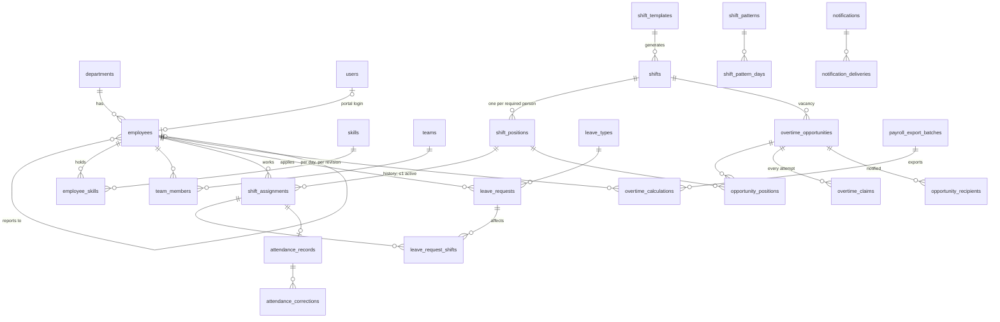

# Workforce & Shift Management — architecture

Status: foundation module (branch `feature/workforce` → `main`). Decisions 1–18 agreed in the
architecture review (`claude.ai` page "Workforce & Shift Architecture"); summarised in §2.

## 1. Purpose
When leave is approved, the employee's shift becomes vacant. The system publishes the vacancy as an
overtime opportunity to the eligible group, and the **first eligible employee whose claim commits**
gets it. The schedule, notifications, attendance and payroll-ready overtime then follow from the
same records. There is no random selection and no ranking.

## 2. Agreed decisions
| # | Decision |
|---|---|
| 1 | Foundation module on `feature/workforce`; merged into `main`, then `main` into client branches |
| 2 | `employees` are separate from `users`; an employee may be linked to one login. Sign-in accepts email **or employee code** |
| 3 | New roles: Employee, Shift Manager, HR Administrator. Manager scope = their user's departments + direct reports |
| 4 | Vacancies publish automatically by default; a department policy can require manager review (draft) |
| 5 | One opportunity per shift, with N positions |
| 6 | Claim deadline = configurable lead time before shift start (default 4 h); optional "claims open at" |
| 7 | Eligibility failures reject the claim with the reason; only a manager can override via manual assignment with a reason |
| 8 | Demo policy values are examples, nothing is hard-coded |
| 9 | Overtime = calculated from verified attendance against policy, approved by a manager |
| 10 | Base hourly rate stored on the employee (HR only); employees see estimates for themselves when enabled |
| 11 | Supervisors record attendance; self check-in is a policy switch (default off); CSV import; no GPS |
| 12 | Yearly leave entitlement, carry-forward cap, half days; half-day cover only by policy or manager |
| 13 | Winner may withdraw until 12 h before start (auto-reopen); leave cancelled after cover → manager-resolved conflict |
| 14 | In-app notifications fully; email when SMTP is configured; push/WhatsApp provider interfaces report "not connected" |
| 15 | Group notifications never reveal who is absent or why |
| 16 | Workforce Agent registered with the Main Agent + `POST /ai/workforce/chat`; employees can ask only about themselves |
| 17 | Employee role gets a mobile-first layout with a bottom tab bar |
| 18 | Monthly payroll batches; exported records locked; later changes become correction lines |

## 3. Module layout
```
backend/app/models/workforce.py              tables below
backend/app/modules/workforce/
  scope.py          who may see which employees (self / department / all)
  policy.py         workforce + overtime policy resolution
  people.py         employees, teams, skills, designations, locations, holidays, portal access
  shifts.py         templates, patterns, shift generation, positions, assignments, copy week
  leave.py          leave types, balances, requests, approval, cancellation
  eligibility.py    the rule engine used for notification, listing, claim and manual assignment
  marketplace.py    vacancy → opportunity, publish, claim (atomic), expire, extend, withdraw, manual assign, conflicts
  attendance.py     check-in/out, supervisor recording, corrections, CSV import, absence marking
  overtime.py       calculation engine, approval, payroll export batches
  notify.py         notification service (dedupe, preferences, delivery log) and providers
  reports.py        workforce / overtime / attendance reports
  router*.py        REST endpoints
backend/app/ai_tools/workforce_tools.py      15 agent tools + 2 approval actions
backend/app/agents/workforce_agent.py        Workforce Agent
```

## 4. Data model
All keys are UUIDs; all instants are `timestamptz`. Shift instants are absolute, so a 22:00–06:00
shift is one range that crosses midnight. Local dates use the company time zone.



### People
| Table | Key columns |
|---|---|
| `employees` | `employee_code` (unique, case-insensitive), names, contact, `department_id`, `designation_id`, `manager_id` → employees, `user_id` (unique, nullable), `status` (active, on_leave, suspended, inactive, terminated), `employment_type`, `date_of_joining`, `work_location_id`, `shift_pattern_id` + `pattern_anchor_date`, `overtime_eligible`, `weekly_hour_limit`, `base_hourly_rate` (HR only), `overtime_policy_id`, emergency contact, photo attachment |
| `designations`, `skills`, `work_locations` | reference data; skills have `kind` (skill / qualification / certification) |
| `employee_skills` | `(employee_id, skill_id)`, `level`, `valid_until` |
| `teams`, `team_members` | eligibility groups inside a department (Assembly, Machine Operations, …) |
| `holidays` | `date`, `name`, `work_location_id` (null = every location) |

### Shifts
| Table | Key columns |
|---|---|
| `shift_templates` | `code`, `name`, `start_time`, `end_time`, `break_minutes`, `department_id`, `work_location_id`, `team_id`, `required_count`, `supervisor_id`, `overtime_policy_id`, `color`; skills in `shift_template_skills` |
| `shift_patterns`, `shift_pattern_days` | rotation of `cycle_days`; each day points to a template or is a weekly off |
| `shifts` | dated instance: `shift_date`, `start_at`, `end_at`, `break_minutes`, department, location, team, `required_count`, supervisor, `status` (scheduled, cancelled); unique `(template_id, shift_date)`; skills in `shift_skills` |
| `shift_positions` | `(shift_id, slot)`; `kind` (regular, cover) — a cover position covers part of a shift (half-day leave) with its own window |
| `shift_assignments` | `position_id`, `shift_id`, `employee_id`, `start_at`, `end_at`, `source` (schedule, marketplace, manual), `status` (assigned, on_leave, released, cancelled), `opportunity_id`, `leave_request_id`, `reason`, `assigned_by` |

**Database guards on `shift_assignments`**
* partial unique index: one `assigned` row per position → staffing can never exceed positions;
* `EXCLUDE USING gist (employee_id WITH =, tstzrange(start_at, end_at) WITH &&) WHERE status = 'assigned'`
  → an employee can never hold two overlapping shifts (requires the trusted `btree_gist` extension).

### Leave
| Table | Key columns |
|---|---|
| `leave_types` | `code`, `name`, `is_paid`, `annual_days`, `carry_forward_max`, `unlimited`, `requires_document`, `allow_half_day` |
| `leave_balances` | `(employee_id, leave_type_id, year)`: `entitled`, `carried_forward`, `adjusted`, `used` (maintained under row lock) |
| `leave_requests` | `number`, employee, type, `start_date`, `end_date`, `half_day` (none, first_half, second_half), `days`, `reason`, `status` (draft, pending, approved, rejected, cancelled), decision fields |
| `leave_request_shifts` | assignments the approved leave took the employee off |
| `leave_approvals` | decision log: submitted / approved / rejected / cancelled, by whom, note |

### Marketplace
| Table | Key columns |
|---|---|
| `overtime_opportunities` | `number`, `shift_id`, department, team, `start_at`, `end_at`, `break_minutes`, `positions_total`, `positions_filled`, `claims_open_at`, `claim_deadline`, `status` (draft, published, open, partially_filled, filled, expired, cancelled), `round`, `source` (leave, manual, ai, withdrawal) |
| `opportunity_positions` | which positions the opportunity fills; `assignment_id` once filled |
| `opportunity_recipients` | `(opportunity_id, employee_id, round)` — who was notified (dedupe) |
| `overtime_claims` | every attempt: employee, server `created_at` (`clock_timestamp()`), `outcome` (won, lost, rejected), `reason_code`, `reason`, `assignment_id`, `idempotency_key` |
| `workforce_conflicts` | `kind` (leave_cancelled_after_cover, withdrawal_after_cutoff), links, `status` (open, resolved), `resolution`, `resolved_by`, `note` |

### Attendance, overtime, payroll
| Table | Key columns |
|---|---|
| `attendance_records` | employee, `assignment_id` (unique), `work_date`, scheduled start/end, `check_in_at`, `check_out_at`, `break_minutes`, `worked_minutes`, `late_minutes`, `early_leave_minutes`, `status` (present, absent, late, half_day, on_leave, holiday, weekly_off), `source` (supervisor, self, import, correction, system) |
| `attendance_corrections` | proposed values, `before` snapshot, reason, `status` (pending, approved, rejected), decision; supervisor edits create auto-approved corrections so every change is on record |
| `workforce_policies` | company default + optional per-department row: `auto_publish`, `claim_deadline_hours`, `min_rest_hours`, `weekly_hour_cap`, `monthly_cover_hours_cap`, `withdrawal_cutoff_hours`, `auto_reopen_on_withdrawal`, `allow_self_check_in`, `half_day_auto_cover`, `show_pay_estimates`, `late_grace_minutes`, `half_day_min_hours` |
| `overtime_policies` | `daily_threshold_hours`, `weekly_threshold_hours`, `ot_multiplier`, `weekly_off_rule` + multiplier, `holiday_rule` + multiplier, night window + allowance per hour, `rounding_minutes`, `rounding_mode`, `min_overtime_minutes`, `requires_approval`, `is_default` |
| `overtime_calculations` | per `(employee_id, work_date, revision)`: worked, regular, daily / weekly / weekly-off / holiday overtime minutes, night minutes, payable minutes, rate snapshot, amount, `status` (calculated, approved, rejected, exported), approved minutes, batch |
| `payroll_export_batches` | `number`, period, department, totals, created by |

### Notifications (extends the ERP's)
* `notifications` gains `dedupe_key` (unique when set).
* `notification_preferences` gains `push` and `whatsapp`.
* `notification_deliveries`: `channel` (in_app, email, push, whatsapp), `provider`, `status` (delivered, pending, sent, failed, skipped), `attempts`, `next_attempt_at`, `last_error`.

Notifications are written in the same transaction as the business change, so a winner is never told
about an assignment that rolled back. Email delivery happens afterwards in the worker, with retries.

## 5. Vacancy → opportunity
On leave approval, in one transaction:
1. lock the request and the balance; check and deduct days;
2. find the employee's `assigned` shifts overlapping the leave (full days in the company time zone);
3. set them to `on_leave` (original kept), link them in `leave_request_shifts`;
4. group the freed positions by shift; for each shift that has not started:
   * add the positions to an existing draft/open opportunity for that shift, or create one;
   * deadline = start − `claim_deadline_hours`, but never later than start;
   * policy `auto_publish` → `open` and notify eligible employees; otherwise `draft` and notify the manager;
5. notify the employee; audit everything.

Half-day leave keeps the assignment. A cover position for half the shift is created only when
`half_day_auto_cover` is on, or when a manager asks for it.

## 6. The claim (first-come-first-served)
```
POST /api/v1/overtime/opportunities/{id}/claim      Idempotency-Key required
BEGIN
  SELECT employee  FOR UPDATE      -- serialises one person's claims (no double-booking races)
  SELECT opportunity FOR UPDATE    -- serialises all claims on this opportunity
  refresh status (published→open, open→expired by time)
  if not open/partially_filled  → claim LOST/REJECTED (reason), COMMIT, 409
  run eligibility rules (§7)    → claim REJECTED (first failing rule), COMMIT, 409/422
  pick the lowest free position
  INSERT shift_assignment       -- unique-per-position + EXCLUDE constraints re-check at the DB
  INSERT overtime_claim WON (created_at = clock_timestamp())
  positions_filled += 1; status = partially_filled | filled
  notify winner; if filled: notify the other recipients "filled"
COMMIT
```
Lock order is always employee → opportunity, so concurrent claims cannot deadlock. The commit order
decides the winner. Losing requests get `409 opportunity_unavailable` with the message
*"This overtime opportunity has already been claimed by another employee."* An idempotent replay
returns the first response.

## 7. Eligibility rules
Evaluated by one engine, used for: choosing recipients, the marketplace "eligible / why not" badge,
the claim, and manual assignment (where violations are shown and need an override reason).

| Code | Rule |
|---|---|
| `inactive` | employee status is active |
| `not_overtime_eligible` | employee is flagged overtime-eligible |
| `wrong_group` | same department; member of the opportunity's team when one is set |
| `missing_skill` | holds every required skill, valid on the shift date |
| `on_leave` | no approved leave overlapping the shift |
| `shift_conflict` | no overlapping assigned shift |
| `rest_period` | at least `min_rest_hours` between this and the neighbouring shifts |
| `weekly_hours` | scheduled hours in the ISO week + this ≤ weekly cap (employee limit, else policy) |
| `monthly_cover_cap` | covered (marketplace/manual) hours in the month + this ≤ policy cap |
| `already_claimed` | not already holding a position in this opportunity |

## 8. Overtime calculation
Per employee per ISO week, from attendance (worked = check-out − check-in − break):
1. holiday → all hours are holiday overtime if the policy says so; weekly off → likewise;
2. otherwise hours above the daily threshold are daily overtime;
3. remaining regular hours accumulate; once the week passes the weekly threshold, the excess is weekly overtime;
4. night-window minutes earn the night allowance;
5. overtime minutes are rounded per policy and ignored below the minimum;
6. amount = overtime hours × base rate × multiplier (+ night allowance).

Records start as `calculated`; a manager approves (optionally fewer minutes) or rejects. Approved
records go into a payroll batch and become `exported` and immutable. If attendance changes later,
the difference is written as a new revision (a correction line) for the next batch.

## 9. API (all under `/api/v1`)
Conventions as in the ERP: JSON, decimals as strings, pagination `page`/`page_size`, error envelope,
`Idempotency-Key` on claim, check-in/out and payroll export.

| Area | Endpoints |
|---|---|
| Me | `GET /workforce/me` (employee, today, upcoming, balances, month overtime, open opportunities count) |
| Employees | `GET/POST /employees`, `GET/PATCH /employees/{id}`, `POST /employees/{id}/portal-access`, skills, teams |
| Reference | `/workforce/designations`, `/skills`, `/teams`, `/locations`, `/holidays`, `/shift-templates`, `/shift-patterns`, `/workforce/policies`, `/overtime/policies`, `/leave/types` |
| Shifts | `GET/POST /shifts`, `PATCH /shifts/{id}`, `POST /shifts/{id}/cancel`, `GET /shifts/calendar`, `POST /shifts/generate`, `POST /shifts/copy-week`, `POST /shifts/{id}/assignments`, `POST /assignments/{id}/release` |
| Leave | `GET/POST /leave/requests`, `GET /leave/requests/{id}`, `POST …/submit`, `…/approve`, `…/reject`, `…/cancel`, `…/attachments`, `GET /leave/balances`, `GET /leave/preview` |
| Overtime | `GET /overtime/opportunities`, `GET /overtime/opportunities/{id}`, `POST …/claim`, `…/publish`, `…/extend`, `…/renotify`, `…/cancel`, `…/assign`, `POST /overtime/opportunities` (manual), `GET /overtime/my-assignments`, `POST /assignments/{id}/withdraw`, `GET /workforce/conflicts`, `POST /workforce/conflicts/{id}/resolve` |
| Attendance | `GET /attendance`, `GET /attendance/day-sheet`, `POST /attendance/check-in`, `…/check-out`, `POST /attendance/record`, `POST /attendance/import`, `GET/POST /attendance/corrections`, `POST /attendance/corrections/{id}/approve|reject` |
| Overtime pay | `GET /overtime/calculations`, `POST /overtime/calculations/recalculate`, `POST /overtime/calculations/{id}/approve|reject`, `GET/POST /payroll/exports`, `GET /payroll/exports/{id}/download?format=csv|xlsx` |
| Dashboards & reports | `GET /workforce/dashboard`, `GET /reports/workforce`, `GET /reports/overtime`, `GET /reports/attendance` |
| AI | `POST /ai/workforce/chat` (and the Main Agent routes workforce questions automatically) |

## 10. Permissions
| Permission | Employee | Shift Manager | HR Admin | Company Admin |
|---|:-:|:-:|:-:|:-:|
| `workforce.self` — own schedule, leave, claims, attendance | ✓ | ✓ | ✓ | ✓ |
| `workforce.view` — employees and schedules in scope | | ✓ | ✓ | ✓ |
| `workforce.schedule` — shifts and assignments | | ✓ | ✓ | ✓ |
| `workforce.leave.approve` | | ✓ | ✓ | ✓ |
| `workforce.overtime.manage` — publish, extend, cancel, manual assign, resolve conflicts | | ✓ | ✓ | ✓ |
| `workforce.attendance.manage` — record, approve corrections | | ✓ | ✓ | ✓ |
| `workforce.overtime.approve` — approve overtime records | | ✓ | ✓ | ✓ |
| `workforce.employees.manage` | | | ✓ | ✓ |
| `workforce.config` — templates, patterns, teams, skills, leave types, policies, holidays | | | ✓ | ✓ |
| `workforce.payroll` — rates and payroll exports | | | ✓ | ✓ |
| `workforce.all_departments` — scope beyond own departments | | | ✓ | ✓ |

Scope is enforced in every service call: employees see only themselves; managers see employees in
their user's departments plus their direct reports; `workforce.all_departments` sees everyone.
Nobody approves their own leave, attendance correction or overtime.

## 11. Background jobs (Celery beat)
| Job | Every | Does |
|---|---|---|
| `workforce.tick` | minute | open published opportunities, expire past-deadline ones (notify manager) |
| `workforce.attendance_close` | 15 min | mark absences for ended shifts without check-in; on-leave records |
| `workforce.deliveries` | minute | send pending email deliveries; retry failed with back-off (max 5) |

Correctness never depends on the scheduler: status is also refreshed when an opportunity is read or claimed.
